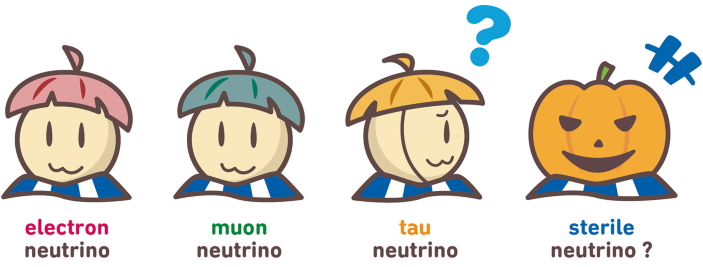
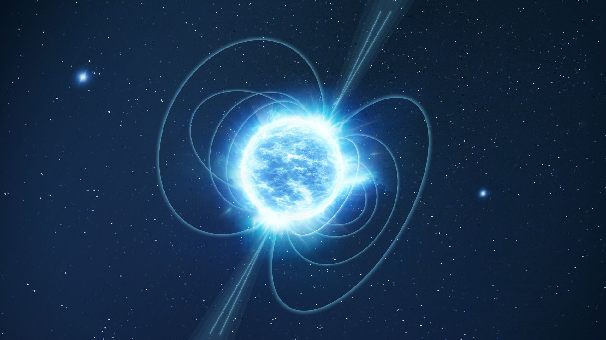
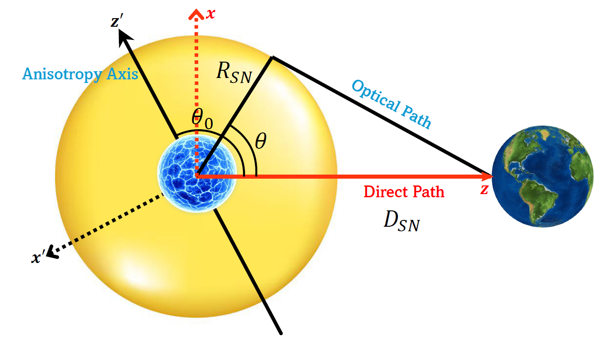

  

  

  

I am a theoretical particle physicist, currently working as a postdoctoral research scholar at Arizona State University, since October 2024. 

Previously, I worked as a postdoctoral associate at Center for Neutrino Physics at Virginia Tech from November 2022 to October 2024. I was also a postdoctoral fellow at UCLouvain in Belgium from December 2021 to October 2022. 

I completed my Ph.D. in Physics from Washington University in St. Louis in December 2021 under the supervision of [Prof. Bhupal Dev](https://sites.wustl.edu/bdev/). Before joining the Ph.D program, I completed my B.E. degree in Electronics and Communication Engineering from University of Delhi in 2016. 

For complete list of publications : [Inspire-HEP](https://inspirehep.net/authors/1724253?ui-citation-summary=true)

Research
======
My current research primarily focuses on investigating beyond the standard model (BSM) neutrino physics especially using astrophysical probes. Top few interesting questions that keep me occupied : 
* How do neutrinos get their masses i.e. what is the elusive neutrino mass mechanism ? Does it involve right-handed neutrinos ?
* How to detect the electromagnetic properties of neutrinos ? 
* How can we detect the Cosmic Neutrino Background ? Can we devise new techniques or improve older techniques for their direct detection ? Indirect detection through their effect on the astrophysical probes?

Some other interesting open problems that fascinate me :
* What is the resolution for the short-baseline neutrino anomalies ? 
* The known values of cosmological constant (CC) and Higgs mass lead to two most important problems in physics. Are these problems connected ? Do these point to missing fundamental ingredients in QFT ?
* What is the microphysical nature of DM? Is it a fermion or a boson? Does physics at short-scales (like numerous galactic scaling laws) offer more hints on DM microphysics?

News
======
* **Oct 2026**: 
	- Invited Talk at Texas A&M University, Mitchell Institute for HEPEC Seminar Series on *Supernova Gamma-Ray Echoes: From Neutrino Emission to New Physics*  
	- Invited Talk at University of Wisconsin–Madison for Theory Seminar (High Energy/Cosmology) on *Prospects for Supernova Magnetometry with Neutrinos*  
* **Sep 2026**: 
	- New paper on *Gamma-Ray Echo as a Probe of Supernova Neutrino Emission Anisotropy and Long-Baseline Effects* [(arxiv: 2609.22806)](https://arxiv.org/abs/2609.22806)
	- New paper on *Supernova Gamma-Ray Echo as an Astrophysical Near Detector for Galactic Neutrino Propagation* [(arxiv: 2609.26908)](https://arxiv.org/abs/2609.26908)
* **Jul 2026**: Presented a Talk at CETUP* 2026 Workshop, The Institute for Underground Science at SURF on *Gamma-Ray Echo as probe of SN Neutrino Emission Anisotropy and Long-
Baseline Effects*  
* **Jun 2026**: Paper on *Resolving the gallium anomaly using an opaque liquid scintillator detector* accepted and published in PRD [(link)](https://journals.aps.org/prd/abstract/10.1103/hlrw-rby4)
* **May 2026**:  
	- My bug fixes for MESA neutrino energy loss rates were successfully reviewed and approved by the MESA developers, and are now available as a dedicated branch of the main code repository [(link)](https://github.com/MESAHub/mesa/pull/998).  
	- Co-organized a Workshop on MultiMessenger Astronomy at ASU [(link)](https://asuworkshop.wixsite.com/multimessengerastro), along with Prof. Cecilia Lunardini.  
	- Presented at ASU Cosmology Friday seminar on  *Gamma-Ray Echo as probe of Neutrino Emission Anisotropy* 
* **Apr 2026**: Taught a graduate lecture on Advanced Quantum Physics at ASU. 
* **Dec 2025**: Presented Talk in 33rd Texas Symposium on Relativistic Astrophysics (ASU) on *511 keV Gamma-Ray Echo from Particle Decays in Supernovae*  
* **Nov 2025**: New paper on *511 keV Gamma Ray Echo from Particle Decays in Supernovae* [(arxiv: 2511.14857)](https://arxiv.org/abs/2511.14857)
* **Oct 2025**:  
	- Invited Talk at SLAC National Accelerator Laboratory for EPP seminar on *Gamma-Ray Echo from Particle Decays in Supernovae*  
	- Invited Talk at University of California Los Angeles (UCLA) for TEPAPP seminar on *Gamma-Ray Echo from Particle Decays in Supernovae*  
	- Paper on *The dark matter diffused supernova neutrino background* accepted and published in JCAP [(link)](https://iopscience.iop.org/article/10.1088/1475-7516/2025/10/020)

